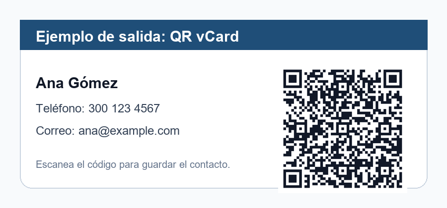

# Generador de códigos QR desde Excel


Convierte una lista de contactos en Excel en códigos QR con formato **vCard 3.0**, listos para escanear con la cámara del celular. El resultado se guarda en una hoja nueva del mismo libro y también como imágenes PNG individuales.



## Qué hace

- Lee los contactos de la hoja `Contactos`.
- Valida que existan las columnas obligatorias.
- Genera un código QR con los datos del contacto en formato vCard.
- Inserta los QR en una hoja nueva llamada `QR_Contactos`.
- Guarda cada QR como PNG en la carpeta `qrs/`.
- Muestra un resumen al terminar y errores claros si falta algo.

## Requisitos

- Python 3.9 o superior
- pandas
- openpyxl
- Pillow
- qrcode

## Instalación

### Windows

```bash
py -3 -m venv .venv
.venv\Scripts\activate
py -3 -m pip install -r requirements.txt
```

### macOS / Linux

```bash
python3 -m venv .venv
source .venv/bin/activate
python -m pip install -r requirements.txt
```

## Formato del Excel

El archivo debe llamarse `contactos.xlsx` y tener una hoja llamada exactamente **`Contactos`**.

La primera fila debe contener estos encabezados, escritos exactamente así:

| Columna | Tipo recomendado | Descripción |
|---|---|---|
| `nombre` | Texto | Nombre del contacto |
| `apellido` | Texto | Apellido del contacto |
| `telefono` | Texto | Número de celular, con indicativo si aplica |
| `email` | Texto | Correo electrónico |

Ejemplo:

| nombre | apellido | telefono | email |
|---|---|---|---|
| Ana | Gómez | 3001234567 | ana@example.com |
| Carlos | Pérez | +57 3109876543 | carlos@example.com |

> Importante: la columna `telefono` debe estar en formato **Texto** para no perder ceros iniciales ni el signo `+`.

Puedes usar `ejemplos/contactos-ejemplo.xlsx` como plantilla. Contiene solo datos ficticios.

## Uso

1. Copia el archivo de ejemplo a la raíz del proyecto:

   ```bash
   cp ejemplos/contactos-ejemplo.xlsx contactos.xlsx
   ```

2. Ejecuta:

   ```bash
   py -3 main.py
   ```

3. Abre `contactos_con_qr.xlsx` y revisa la hoja `QR_Contactos`.

También puedes indicar otras rutas:

```bash
py -3 main.py --input ruta/contactos.xlsx --output ruta/resultado.xlsx --qr-dir ruta/qrs
```

Opciones disponibles:

| Opción | Valor por defecto | Descripción |
|---|---|---|
| `-i`, `--input` | `contactos.xlsx` | Excel de entrada |
| `-o`, `--output` | `contactos_con_qr.xlsx` | Excel de salida |
| `--qr-dir` | `qrs` | Carpeta de los PNG |

## Salida

```text
contactos_con_qr.xlsx   # Excel original + hoja QR_Contactos
qrs/
├── Ana_Gómez.png
└── Carlos_Pérez.png
```

Si el libro ya tiene una hoja `QR_Contactos`, se reemplaza. Los nombres de archivo se limpian y se numeran si hay duplicados.

## Estructura del proyecto

```text
qr-contactos-excel/
├── main.py
├── requirements.txt
├── README.md
├── LICENSE
├── .gitignore
├── ejemplos/
│   └── contactos-ejemplo.xlsx
├── docs/
│   └── ejemplo-tarjeta.png
└── tests/
    └── test_main.py
```

## Pruebas

El proyecto usa `unittest`, incluido en Python:

```bash
py -3 -m unittest discover -s tests -v
```

Las pruebas cubren:

- Generación del vCard y escape de caracteres especiales.
- Nombres de archivo seguros y duplicados.
- Validación de columnas faltantes.
- Flujo completo con un Excel temporal.

## Manejo de errores

- Si falta `contactos.xlsx`, se muestra un mensaje claro.
- Si falta la hoja `Contactos` o alguna columna, se indica cuál falta.
- Si el Excel de salida está abierto, se pide cerrarlo antes de reintentar.
- Si no hay contactos, no se genera un archivo vacío.

## Privacidad

No subas contactos reales al repositorio. El `.gitignore` excluye los `.xlsx`, excepto el archivo de ejemplo con datos ficticios. Los QR generados en `qrs/` también se excluyen.

## Limitaciones

- Trabaja con archivos `.xlsx`; no conserva macros de `.xlsm`.
- No valida formato de teléfono ni de correo.
- No incluye fotos de contacto en el vCard.
- La lectura de la hoja usa pandas; si el Excel tiene fórmulas complejas, conviene revisar el resultado.

## Licencia

MIT. Consulta [LICENSE](LICENSE).
